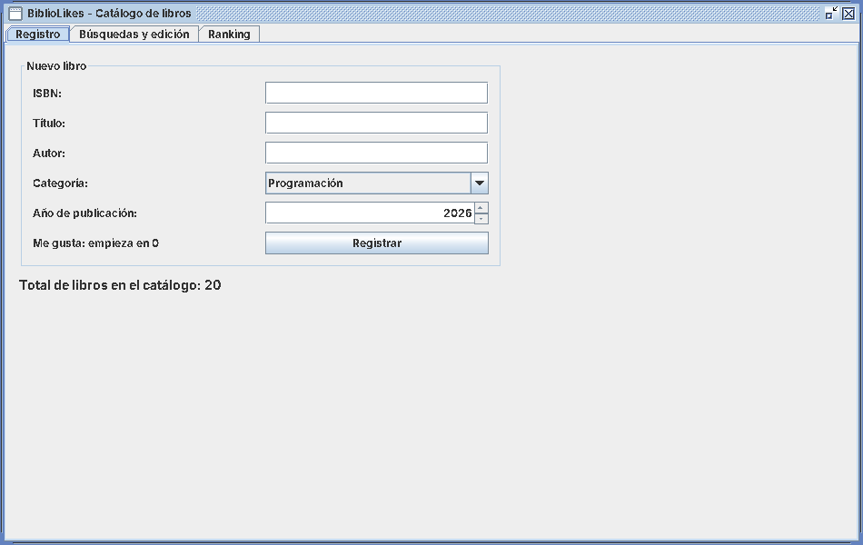
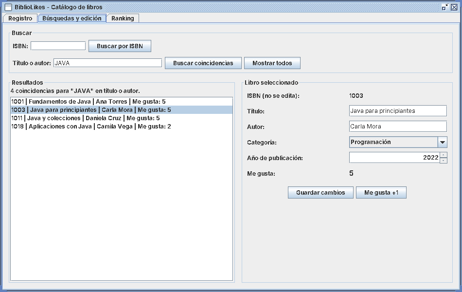
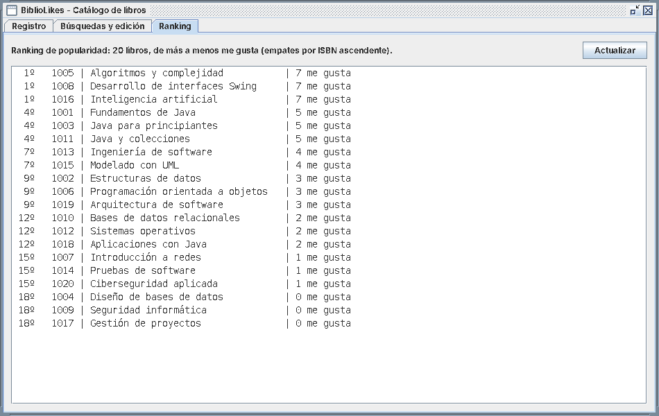

# Taller BiblioLikes

## Enunciado

La biblioteca de una universidad desea ampliar el catálogo de libros que el equipo ha desarrollado en clases. Además de registrar y consultar libros, los usuarios podrán localizar un ejemplar, editar su información y expresar su interés mediante un botón «Me gusta». La biblioteca necesita un ranking de libros populares que admita empates.

Extiendan el proyecto existente utilizando **ArrayList, búsqueda lineal, búsqueda binaria, ordenamiento burbuja y Java Swing**. No es necesario comenzar otro sistema: adapten las clases y métodos que ya trabajaron.

El equipo tendrá un único repositorio de GitHub. Deben existir commits de código provenientes de **al menos tres cuentas distintas**, con al menos un commit significativo por cuenta. Todos los integrantes deben poder explicar su aporte. No se exigen ramas ni pull requests.

## Datos del libro

| Atributo | Tipo | Regla |
|---|---|---|
| `codigo` | `int` | Positivo, único e inmutable después del registro. |
| `titulo` | `String` | Obligatorio; puede coincidir con el título de otro libro. |
| `autor` | `String` | Obligatorio; puede repetirse. |
| `genero` | `String` | Obligatorio; seleccionado de un JComboBox. |
| `anio` | `int` | Desde 1 hasta el año actual. |
| `meGusta` | `int` | No negativo; empieza en 0 para nuevos registros. Aumenta con el botón Me gusta. |

Las categorías de este ejemplo son Programación, Bases de datos, Redes, Seguridad, Sistemas, Software, IA y Gestión. Pueden adaptar las etiquetas al modelo que ya tienen, conservando las reglas.

## Organización de las colecciones

La colección principal será `ArrayList<Libro> libros`. Debe permanecer ordenada por código ascendente para aplicar búsqueda binaria.

Para construir el ranking, creen una copia con `new ArrayList<>(libros)` y ordenen esa copia por `meGusta` descendente mediante burbuja. No ordenen la colección principal por me gusta: una búsqueda binaria por código sobre una lista organizada por popularidad puede devolver resultados incorrectos.

Los objetos Libro de las copias representan los mismos registros. Editar un libro debe actualizar su información en el catálogo; no se debe crear un registro distinto para mostrarlo en resultados o ranking. Ninguna búsqueda debe eliminar libros de la colección principal.

## Requerimientos funcionales

### R1 Cargar veinte registros al iniciar

- Precargar exactamente 20 libros de demostración utilizando `DatosIniciales.cargar()` o un método equivalente.
- Los códigos serán únicos y existirán valores repetidos en género, año y me gusta.
- Ordenar los datos por código con burbuja antes de habilitar la búsqueda binaria.
- Cargar los datos una sola vez por ejecución. Cambiar de pestaña, buscar o actualizar el ranking no debe volver a cargarlos ni duplicarlos.
- Mostrar la cantidad actual de libros. La información se conserva en memoria durante la sesión; no se exige base de datos ni archivos.

### R2 Registrar nuevos libros

- Crear un formulario con código, título, autor, género y año, más un botón Registrar.
- Validar campos obligatorios, código positivo, año permitido y código no repetido.
- Inicializar los me gusta del nuevo libro en 0; este valor no se ingresa manualmente en el formulario.
- Si el registro es válido, añadirlo al ArrayList y aplicar burbuja por código para mantener la condición de la búsqueda binaria.
- Si falla una validación, mostrar un mensaje y conservar los datos anteriores.

El usuario puede registrar un código menor que los existentes, por ejemplo 999. Por tanto, no se debe asumir que todos los nuevos códigos llegan al final del orden numérico.

### R3 Buscar coincidencias de texto y devolver un ArrayList

Implementar una búsqueda lineal que inspeccione título y autor y devuelva todas las coincidencias parciales.

```java
public ArrayList<Libro> buscarCoincidencias(String texto)
```

- Ignorar diferencias entre mayúsculas y minúsculas; eliminar espacios al inicio y al final de la consulta.
- Un libro coincide si el fragmento aparece en su título **o** en su autor. Si coincide en ambos, incluirlo una sola vez.
- Devolver un ArrayList nuevo; si no hay coincidencias, devolver uno vacío, no `null`.
- Rechazar una consulta vacía o formada solo por espacios.
- Mostrar los resultados en una `JList<Libro>` mediante `DefaultListModel<Libro>` y el número de coincidencias.
- Mantener el orden por código de los resultados y permitir seleccionar uno para mostrar su detalle.

Para esta práctica no es obligatorio ignorar tildes. Buscar `JAVA` debe comportarse igual que buscar `java`.

### R4 Buscar por código con búsqueda binaria y editar

Implementar una búsqueda binaria propia sobre la colección principal ordenada por código.

```java
public int buscarIndicePorCodigo(int codigo)
```

- Devolver el índice encontrado o `-1` si no existe.
- Rechazar códigos no positivos.
- Al encontrar un libro, mostrar sus datos en un formulario de edición y seleccionarlo en la JList de resultados.
- Permitir editar título, autor, género y año. El código no se modifica y me gusta no se escribe desde el formulario.
- Validar todos los datos antes de guardar: si algún campo es inválido, no realizar cambios parciales.
- Si no se encuentra un libro, mostrar un aviso y evitar que se edite o se dé me gusta al libro de una consulta anterior.
- Actualizar los datos visibles después de guardar, conservando el orden por código de la colección principal.

Los resultados de la búsqueda lineal también pueden seleccionarse para editar. Para identificar el registro que se va a guardar, utilizar su código único, no el índice de la JList ni el título.

### R5 Dar me gusta a un libro seleccionado

- Después de buscar por código o texto, seleccionar un libro y pulsar el botón **Me gusta +1**.
- Cada clic válido aumenta únicamente en uno el contador de ese libro.
- Mostrar el nuevo contador y actualizar las vistas afectadas.
- Si no hay selección válida, mostrar un aviso sin modificar ningún contador.
- Para esta simulación se permiten varios clics sobre un mismo libro. No hay cuentas de lectores, restricción de un voto por usuario ni operación «quitar me gusta».

El evento de selección de la JList solo muestra el detalle. El contador aumenta cuando se pulsa el botón, no al cambiar la selección ni al refrescar una lista.

### R6 Ordenar el ranking por un atributo repetido

Crear un método que devuelva los libros ordenados por popularidad:

```java
public ArrayList<Libro> obtenerRanking()
```

- Crear una copia del ArrayList principal y ordenarla con burbuja por me gusta descendente.
- Conservar todos los libros, incluso cuando sus contadores sean iguales.
- En los empates, mostrar código ascendente. Una forma de lograrlo es partir de la colección principal ordenada por código y utilizar burbuja estable: intercambiar solo cuando el elemento izquierdo tiene menos me gusta que el derecho.
- Mostrar código, título y contador en una JList de ranking.
- Actualizar el ranking al entrar en la pestaña o pulsar Actualizar. Debe reflejar los registros, cambios y clics realizados durante la sesión.
- Volver a buscar por código después de consultar el ranking debe seguir funcionando correctamente.

## Interfaz requerida con JTabbedPane

| Pestaña | Controles mínimos | Comportamiento |
|---|---|---|
| Registro | JTextField para código, título y autor; JComboBox para género; JSpinner para año; botón Registrar; total de libros. | Registrar y validar datos nuevos. |
| Búsquedas y edición | Campo de código y botón Buscar por código; campo de texto y botón Buscar coincidencias; JList de resultados; formulario de edición; botones Guardar cambios y Me gusta +1; contador visible. | Buscar, seleccionar un registro, editarlo y aumentar sus me gusta. |
| Ranking | JList de libros con sus contadores; botón Actualizar. | Mostrar popularidad descendente sin alterar el orden del catálogo principal. |

Después de registrar, editar o dar me gusta, refrescar los datos correspondientes sin reinicializar el catálogo. Si una edición hace que un libro deje de cumplir la búsqueda de texto activa, retirarlo de esos resultados al recalcular la consulta y limpiar la selección si corresponde.

## Organización sugerida del código

| Clase | Responsabilidad |
|---|---|
| `Libro` | Datos del libro y operaciones sobre sus atributos. |
| `CatalogoLibros` | ArrayList principal, validaciones, búsquedas, ediciones, me gusta y ordenamientos. |
| `DatosIniciales` | Construir los 20 libros de demostración. |
| `Ventana` o clase existente de interfaz | JTabbedPane, controles, selección y mensajes. |

Firmas orientativas adicionales:

```java
public void registrar(Libro libro)
public void editarLibro(int codigo, String titulo, String autor,
                        String genero, int anio)
public void darMeGusta(int codigo)
public void ordenarPorCodigoBurbuja()
```

Mantener los algoritmos en el modelo, separados de los eventos Swing. Los alumnos pueden adaptar nombres a su proyecto, pero deben conservar el comportamiento solicitado.

Para los algoritmos evaluados, no utilizar `Collections.sort()`, `List.sort()`, `Arrays.sort()`, `stream().sorted()` ni `Collections.binarySearch()`. El propósito es aplicar los métodos de burbuja y búsqueda binaria desarrollados en clase.

## Registros de demostración

Todos los libros, autores y años de esta tabla son datos ficticios para el ejercicio.

| Código | Título | Autor | Género | Año | Me gusta |
|---|---|---|---|---|---|
| 1001 | Fundamentos de Java | Ana Torres | Programación | 2021 | 5 |
| 1002 | Estructuras de datos | Luis Vega | Programación | 2020 | 3 |
| 1003 | Java para principiantes | Carla Mora | Programación | 2022 | 5 |
| 1004 | Diseño de bases de datos | Pedro León | Bases de datos | 2019 | 0 |
| 1005 | Algoritmos y complejidad | Sofía Paz | Programación | 2023 | 7 |
| 1006 | Programación orientada a objetos | Diego Ruiz | Programación | 2021 | 3 |
| 1007 | Introducción a redes | Elena Ramos | Redes | 2020 | 1 |
| 1008 | Desarrollo de interfaces Swing | Pablo Soto | Programación | 2024 | 7 |
| 1009 | Seguridad informática | Laura Díaz | Seguridad | 2022 | 0 |
| 1010 | Bases de datos relacionales | Marco Vera | Bases de datos | 2020 | 2 |
| 1011 | Java y colecciones | Daniela Cruz | Programación | 2025 | 5 |
| 1012 | Sistemas operativos | Andrés Luna | Sistemas | 2021 | 2 |
| 1013 | Ingeniería de software | Gabriela Ríos | Software | 2023 | 4 |
| 1014 | Pruebas de software | Mateo Peña | Software | 2022 | 1 |
| 1015 | Modelado con UML | Valeria Sol | Software | 2024 | 4 |
| 1016 | Inteligencia artificial | Nicolás López | IA | 2025 | 7 |
| 1017 | Gestión de proyectos | Paula Reyes | Gestión | 2021 | 0 |
| 1018 | Aplicaciones con Java | Camila Vega | Programación | 2023 | 2 |
| 1019 | Arquitectura de software | Tomás León | Software | 2024 | 3 |
| 1020 | Ciberseguridad aplicada | Isabel Rojas | Seguridad | 2025 | 1 |

Se incluye `DatosIniciales.java` con estos veinte registros quemados y una clase `Libro.java` de referencia para integrarlos. Pueden adaptar el constructor a la clase del proyecto existente. La carga entrega los datos desordenados intencionalmente; el equipo debe aplicar burbuja por código al iniciar.

## Casos de comprobación

| Caso | Acción | Resultado esperado |
|---|---|---|
| 1 | Iniciar y cambiar varias veces de pestaña. | Exactamente 20 registros, sin duplicaciones. |
| 2 | Intentar registrar otro código 1001. | Error; cantidad y libro original sin cambios. |
| 3 | Registrar código 999 con datos válidos. | Total 21; queda antes que 1001 en la colección principal y la búsqueda binaria lo encuentra. |
| 4 | Buscar `JAVA` antes de editar o agregar registros. | ArrayList con 1001, 1003, 1011 y 1018. |
| 5 | Buscar `bases` con los datos iniciales. | ArrayList con 1004 y 1010. |
| 6 | Buscar `vega` con los datos iniciales. | ArrayList con 1002 y 1018, por coincidencia en autor. |
| 7 | Buscar texto inexistente. | ArrayList vacío y mensaje; ninguna selección anterior permanece activa. |
| 8 | Buscar 1015 y editar su título con datos válidos. | Se actualiza ese registro; código y me gusta se conservan. |
| 9 | Intentar editar con autor vacío. | Error y ningún atributo cambia parcialmente. |
| 10 | Consultar el ranking inicial. | Primeros: 1005, 1008 y 1016, todos con 7. Permanecen los 20 libros. |
| 11 | Buscar 1001 y pulsar tres veces Me gusta +1. | Pasa de 5 a 8; al actualizar el ranking queda primero. |
| 12 | Después de ordenar el ranking, buscar 1004 mediante binaria. | Se encuentra; la colección principal continúa ordenada por código. |
| 13 | Pulsar Me gusta +1 sin un libro seleccionado. | Aviso; no cambia ningún contador. |
| 14 | Buscar 9999 después de consultar un libro existente. | No encontrado; Guardar y Me gusta no deben afectar el libro anterior. |

Los casos que indican «datos iniciales» deben ejecutarse en una sesión nueva o antes de modificar ese conjunto.

## Trabajo en GitHub y entrega

1. Crear **un repositorio por equipo**, accesible para el docente.
2. Realizar aportes de código desde **al menos tres cuentas distintas**. Cada integrante debe tener como mínimo un commit significativo y atribuible a su cuenta.
3. Trabajar por turnos o con el procedimiento que conocen para subir código; no es obligatorio utilizar ramas ni pull requests.
4. Entregar el enlace, el código integrado, capturas de las tres pestañas y evidencia de los casos de comprobación.
5. Completar la tabla de aportes y preparar una demostración de búsqueda, edición, clics de me gusta y ranking.

| Integrante | Usuario GitHub | Funcionalidad desarrollada | Enlace al commit |
|---|---|---|---|
| Zaid Chamorro | [zaid290](https://github.com/zaid290) | R1 y R2: carga única de los 20 libros, ordenamiento burbuja por ISBN, registro con validaciones y pestaña Registro (interfaz Swing escrita a mano). | [bebc966](https://github.com/zaid290/Taller_BiblioLikes/commit/bebc966297e1af80a5d7e4bd78a8e0c7360973f4) |
| Esteban Chapaca | [Esteban201020](https://github.com/Esteban201020) | R3 y R4: búsqueda lineal de coincidencias en título o autor, búsqueda binaria por ISBN, edición y pestaña Búsquedas y edición. | [fa26153](https://github.com/zaid290/Taller_BiblioLikes/commit/fa2615371da73ea2dd33f540078334a89263edc0) |
| Mahe Paredes | [maheparedes](https://github.com/maheparedes) | R5 y R6: botón Me gusta +1 y ranking con burbuja estable por me gusta, empates por ISBN y pestaña Ranking. | [90cb1c6](https://github.com/zaid290/Taller_BiblioLikes/commit/90cb1c6201b4193b63f65348237311d4f3b5d676) |

Verificar que GitHub asocie los commits a sus cuentas; si utilizan Git local, el correo configurado debe estar asociado a la cuenta correspondiente. El número de commits no sustituye la explicación del aporte.

## RUBRICA

1. Funcionamiento **cualquier integrante ejecuta**, 3Puntos.
2. Intefaz realizada manualmente por estudiantes **cualquier integrante ejecuta**, 3Puntos.
3. Github **cualquier integrante explica**, 4Puntos.

## Capturas de las tres pestañas

### Registro



### Búsquedas y edición



### Ranking



## Evidencia de los casos de comprobación

Los casos con datos iniciales (1, 4, 5, 6, 7 y 10) se ejecutaron primero, al iniciar la sesión; los demás se ejecutaron después, en la misma sesión y en el orden 2, 3, 8, 9, 11, 12, 13 y 14.

| Caso | Acción | Resultado esperado | Resultado obtenido | Evidencia |
|---|---|---|---|---|
| 1 | Iniciar y cambiar varias veces de pestaña. | Exactamente 20 registros, sin duplicaciones. | Después de 9 cambios de pestaña el total sigue en 20 y «Mostrar todos» lista los 20 libros (1001 a 1020), sin repetidos. | [1a](evidencias/caso01a_total_20.png) · [1b](evidencias/caso01b_mostrar_todos_20.png) |
| 2 | Intentar registrar otro código 1001. | Error; cantidad y libro original sin cambios. | Mensaje «Ya existe un libro con el ISBN 1001.»; el total sigue en 20 y el 1001 sigue siendo «Fundamentos de Java», de Ana Torres, con 5 me gusta. | [2a](evidencias/caso02a_isbn_repetido_error.png) · [2b](evidencias/caso02b_original_sin_cambios.png) |
| 3 | Registrar código 999 con datos válidos. | Total 21; queda antes que 1001 en la colección principal y la búsqueda binaria lo encuentra. | Mensaje «Libro registrado correctamente. Total de libros: 21»; en «Mostrar todos» el 999 aparece primero, antes del 1001, y la búsqueda binaria lo encuentra en el índice 0. | [3a](evidencias/caso03a_registro_999.png) · [3b](evidencias/caso03b_999_antes_de_1001.png) · [3c](evidencias/caso03c_binaria_encuentra_999.png) |
| 4 | Buscar `JAVA` antes de editar o agregar registros. | ArrayList con 1001, 1003, 1011 y 1018. | 4 coincidencias: 1001, 1003, 1011 y 1018. | [4](evidencias/caso04_buscar_JAVA.png) |
| 5 | Buscar `bases` con los datos iniciales. | ArrayList con 1004 y 1010. | 2 coincidencias: 1004 y 1010. | [5](evidencias/caso05_buscar_bases.png) |
| 6 | Buscar `vega` con los datos iniciales. | ArrayList con 1002 y 1018, por coincidencia en autor. | 2 coincidencias por autor: 1002 (Luis Vega) y 1018 (Camila Vega). | [6](evidencias/caso06_buscar_vega.png) |
| 7 | Buscar texto inexistente. | ArrayList vacío y mensaje; ninguna selección anterior permanece activa. | Con el 1001 seleccionado se buscó «computación cuántica»: aviso «No hay coincidencias…», lista con 0 coincidencias y formulario sin libro seleccionado. | [7a](evidencias/caso07a_texto_inexistente_mensaje.png) · [7b](evidencias/caso07b_sin_seleccion.png) |
| 8 | Buscar 1015 y editar su título con datos válidos. | Se actualiza ese registro; código y me gusta se conservan. | Mensaje «Cambios guardados.»; el título pasó a «Modelado de software con UML» y se conservan el ISBN 1015 y sus 4 me gusta. | [8](evidencias/caso08_editar_titulo_1015.png) |
| 9 | Intentar editar con autor vacío. | Error y ningún atributo cambia parcialmente. | Se cambiaron título y categoría y se dejó el autor vacío: error «El autor es obligatorio.». Al volver a buscar 1015, título, autor y categoría siguen iguales. | [9a](evidencias/caso09a_autor_vacio_error.png) · [9b](evidencias/caso09b_ningun_cambio_parcial.png) |
| 10 | Consultar el ranking inicial. | Primeros: 1005, 1008 y 1016, todos con 7. Permanecen los 20 libros. | 1º 1005, 1º 1008 y 1º 1016, los tres con 7 me gusta; el ranking muestra los 20 libros. | [10](evidencias/caso10_ranking_inicial.png) |
| 11 | Buscar 1001 y pulsar tres veces Me gusta +1. | Pasa de 5 a 8; al actualizar el ranking queda primero. | El contador pasó de 5 a 6, 7 y 8; en el ranking el 1001 queda 1º con 8 me gusta. | [11a](evidencias/caso11a_me_gusta_5_a_8.png) · [11b](evidencias/caso11b_ranking_1001_primero.png) |
| 12 | Después de ordenar el ranking, buscar 1004 mediante binaria. | Se encuentra; la colección principal continúa ordenada por código. | La búsqueda binaria encuentra el 1004 en el índice 4 y «Mostrar todos» sigue en orden de ISBN (999, 1001, 1002…). | [12a](evidencias/caso12a_binaria_1004.png) · [12b](evidencias/caso12b_catalogo_sigue_por_isbn.png) |
| 13 | Pulsar Me gusta +1 sin un libro seleccionado. | Aviso; no cambia ningún contador. | Aviso «Primero busque y seleccione un libro para darle me gusta.»; el ranking queda igual (1001 con 8; 1005, 1008 y 1016 con 7). | [13](evidencias/caso13_me_gusta_sin_seleccion.png) |
| 14 | Buscar 9999 después de consultar un libro existente. | No encontrado; Guardar y Me gusta no deben afectar el libro anterior. | Con el 1002 consultado (3 me gusta) se buscó 9999: aviso «No se encontró ningún libro con el ISBN 9999.» y formulario vacío. Me gusta +1 y Guardar cambios solo muestran aviso; el 1002 sigue con 3 me gusta. | [14a](evidencias/caso14a_9999_no_encontrado.png) · [14b](evidencias/caso14b_1002_sin_cambios.png) |
